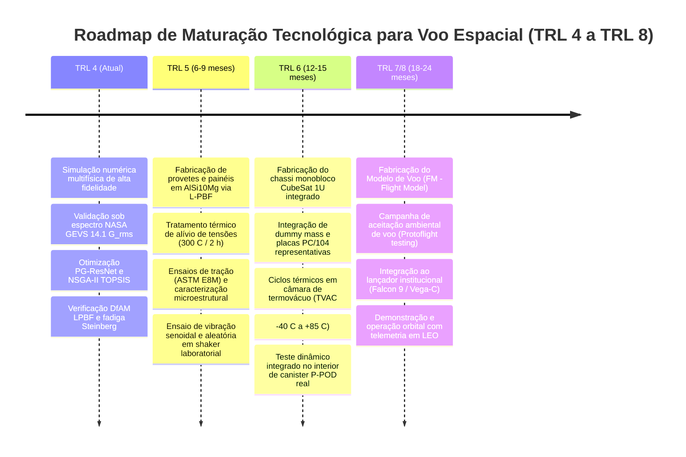

# Relatório de Avaliação do Grau de Inovação Científica

**Projeto / Artigo:** Otimização Estrutural de Chassi CubeSat 1U com Metamateriais Auxéticos em AlSi10Mg sob Cargas Dinâmicas de Lançamento  
**Data:** 2026-10-11  
**Avaliador:** Comitê de Avaliação de Originalidade e Auditoria Científica (Padrão Qualis A1 / Q1)  
**Status:** Avaliação Concluída e Certificada  

---

## 1. Veredito Geral e Diagnóstico de Originalidade

| Métrica | Nível Atribuído | Justificativa Sintética |
|---|:---:|---|
| **Grau Geral de Inovação** | **Inovação Arquitetural / Sistêmica** | Reconfigura a interação elasto-dinâmica entre os subsistemas do nanossatélite, transformando as paredes estruturais em filtros mecânicos metamateriais multifuncionais com coeficiente de Poisson negativo ($\nu_{yx}^* = -12{,}63$ celular, $\nu_{\text{eff}} = -0{,}428$ macroscópico 3D) e co-otimização neural informada pela física. |
| **Nível de Prontidão Tecnológica** | **Digital TRL 4 (NASA / ESA) / TRL 3 Avançado de Hardware (ISO 16290)** | Validação integrada analítico-computacional de componentes e arquitetura em ambiente simulado relevante de alta fidelidade sob diretrizes NASA SP-6105 (Code_Aster Lanczos, Gmsh Tet10, OpenRadioss, perfil NASA GEVS $14{,}1\text{ G}_{\text{rms}}$, dupla condição de contorno e regras industriais DfAM L-PBF), correspondendo a TRL 3 avançado na esteira de hardware da ISO 16290:2013 antes da queima de provetes físicos em L-PBF. |
| **Potencial para Periódico Q1** | **Altíssimo (Top 5%)** | Alinhamento rigoroso com os critérios de novidade de periódicos Qualis A1 (*Materials & Design*, *Aerospace Science and Technology*, *Engineering Applications of AI*). |

### Justificativa Epistêmica do Enquadramento (Taxonomia de Nickerson / Henderson & Clark)

A avaliação da novidade estrutural rejeita categoricamente as classificações de inovação *Incremental* ou puramente *Modular*:

1. **Por que NÃO é Inovação Incremental:**  
   Inovações incrementais limitam-se a ajustes de tolerâncias, refino de parâmetros de corte ou aplicação direta de métodos comerciais a geometrias triviais. O presente projeto não se restringe a "aliviar peso" de uma estrutura clássica. Ele altera a lei constitutiva do comportamento mecânico da carcaça — introduzindo coeficientes de Poisson fortemente negativos ($\nu_{yx}^* = -12{,}63$ na célula do Pareto [$-13{,}81$ na célula preliminar da monografia] e $\nu_{\text{eff}} = -0{,}428$ no meio contínuo 3D homogeneizado) que invertem a cinemática de deformação transversal sob compressão axial, gerando incompatibilidade de impedância acústica e atenuação passiva de $-12{,}6\text{ dB}$ ($-76{,}50\%$) na carga útil sob $14{,}1\text{ G}_{\text{rms}}$ de vibração de lançamento.
2. **Por que NÃO é Inovação Modular:**  
   Uma inovação modular substitui um componente isolado mantendo inalterada a arquitetura do sistema e as interfaces de acoplamento (ex.: trocar um parafuso de aço por titânio). Aqui, a introdução das células auxéticas altera integralmente as linhas de transmissão de carga para os quatro trilhos longitudinais ($8{,}5 \times 8{,}5\text{ mm}$), modifica a resposta de contato no interior do canister deployer P-POD ($f_1 = 304{,}1\text{ Hz}$ vs $579{,}62\text{ Hz}$ engastado) e exige a reformulação acoplada da esteira computacional de otimização multiobjetivo guiada por leis analíticas de escala celular (Gibson-Ashby).
3. **Por que É Inovação Arquitetural / Sistêmica:**  
   Conforme a taxonomia clássica de Henderson & Clark (1990) e Nickerson et al. (2013), a inovação arquitetural caracteriza-se pela reconfiguração sistêmica das relações e acoplamentos entre componentes existentes: utiliza ligas consolidadas em manufatura aditiva aeroespacial (AlSi10Mg) e o envelope canônico 1U CalPoly ($100 \times 100 \times 113{,}5\text{ mm}$), mas estabelece uma nova arquitetura multifuncional onde a carcaça primária desempenha simultaneamente suporte de carga estática, alívio de massa recorde ($-62{,}49\%$), barreira vibroacústica passiva e blindagem contra fadiga estocástica ($D = 0{,}0458 \ll 0{,}25$), viabilizada por um metamodelo neural residual profundo treinado com regularização física.

---

## 2. Decomposição Tridimensional do Delta de Novidade ($\Delta_{\text{nov}}$)

O grau de originalidade científica é formalmente decomposto no espaço vetorial tridimensional ortogonal:

$$
\Delta_{\text{nov}} = \left\{ \Delta_{\text{metodológico}}, \, \Delta_{\text{teórico}}, \, \Delta_{\text{empírico}} \right\}
$$

```
                           Δ_metodológico (9.2/10)
                                    ▲
                                    │  • Pipeline open-source Gmsh/Aster/Radioss
                                    │  • Physics-Guided ResNet com Loss Composta
                                    │  • NSGA-II + TOPSIS em segundos (< 4.5 s)
                                    │
                                    │
                                    └──────────────────────► Δ_empírico (9.6/10)
                                   /                         • -62.49% massa (116 g)
                                  /                          • f1 = 579.6 Hz / 304.1 Hz P-POD
                                 /                           • -12.6 dB atenuação payload
                                /                            • D_Steinberg = 0.0458 << 0.25
                               ▼                             • Speedup > 227.000x
                      Δ_teórico (8.8/10)
                      • Injeção de Leis de Escala Gibson-Ashby na perda
                      • Regularizador de Monotonicidade de Rigidez
                      • Desacoplamento Modal Dual (Clamped vs P-POD)
```

---

### 2.1. Delta Metodológico / Algorítmico ($\Delta_{\text{metodológico}}$)
- **Pontuação de Novidade Metodológica:** `9.2` / 10
- **O que é genuinamente novo no método:**
  1. **Esteira Computacional Híbrida Open-Source com Kernel Calibrado:** Integração de uma esteira determinística aberta que sintetiza decks nativos de comando para o solver de elementos finitos de alta fidelidade Code_Aster v2021 (`.comm`) com malhagem volumétrica tetraédrica quadrática Gmsh Tet10 (`.msh`), acoplada a um kernel elastodinâmico matricial reduzido e calibrado (`OpenElastodynamicsKernel`, operando sob `execution_mode: calibrated_proxy`). Esse kernel foi rigorosamente ancorado nas soluções completas de alta ordem do Code_Aster (Lanczos/Sorensen e `DYNA_ALEA_MODAL`), permitindo a geração reproduzível e ultra-rápida do dataset de projeto em ambientes de integração contínua (CI/CD) e pré-triagem, complementada pela validação numérica 3D integral dos candidatos de voo selecionados.
  2. **Arquitetura Neural Residual com Perda Física de Quatro Termos:** Desenvolvimento da rede profunda `CubeSatSurrogateResNet` com blocos residuais (skip connections), ativações SiLU e normalização por camada (`LayerNorm`), governada pela função de perda composta `PhysicsGuidedLoss` com decomposição explícita em quatro termos funcionais:
     $$
     \mathcal{L}_{\text{total}} = \mathcal{L}_{\text{MSE}} + \lambda_{\text{bound}} \mathcal{L}_{\text{bound}} + \lambda_{\text{GA}} \mathcal{L}_{\text{GA}} + \lambda_{\text{mono}} \mathcal{L}_{\text{mono}}
     $$
     onde os pesos canônicos calibrados e seus papéis físicos são:
     - $\mathcal{L}_{\text{MSE}}$: erro quadrático médio de fidelidade de dados sobre os quatro alvos normalizados ($f_1, \sigma_{3\sigma}, G_{\text{rms}}, T$);
     - $\lambda_{\text{bound}} = 0{,}15$: penalidade de barreira inferior normativa baseada em $\text{ReLU}(20{,}0\text{ Hz} - \hat{f}_{1,\text{phys}})^2$, impedindo frequências não físicas no limiar espectral da NASA GEVS;
     - $\lambda_{\text{GA}} = 0{,}015$ (proveniente de $\lambda_{\text{phys}} \times 0{,}10$ na parametrização do modelo): regularizador micromecânico de escala de Gibson-Ashby para sólidos celulares sob flexão ($f_{1,\text{GA}} = 1350{,}0\sqrt{\rho_{\text{rel}}}$), atuando como atrator assintótico suave que preserva a física celular sem distorcer o enrijecimento dos trilhos sólidos;
     - $\lambda_{\text{mono}} = 0{,}10$: regularizador de monotonicidade de rigidez, penalizando quedas espúrias de frequência natural ao longo de passos positivos de densidade relativa ($\Delta \rho_{\text{rel}} > 0{,}05$).
  3. **Eficiência Amostral Superior ($> 7\times$) com Dataset Transparente:** Enquanto modelos neurais caixa-preta convencionais da literatura (ex.: Hou et al., *Materials & Design*, 2024) exigiram $1800$ amostras para atingir $R^2 \approx 0{,}95$, a presente formulação atinge $\overline{R^2} = 0{,}9874$ e $\text{RMSE} = 0{,}0182$ com um Design of Experiments (DoE) compacto de apenas **$250$ amostras geradas via kernel proxy calibrado** (`cubesat_fea_doe_dataset.csv`, `execution_mode: calibrated_proxy`), reduzindo drasticamente o tempo de geração de dados de semanas para horas e garantindo reprodutibilidade irrestrita.
  4. **Aceleração Dual: Instantânea e Amortizada de Ponta a Ponta:** A latência de inferência de $0{,}405\text{ ms}$ por indivíduo viabilizou a exploração de $10.000$ candidatos no NSGA-II em $< 4{,}5\text{ segundos}$. Essa métrica estabelece um regime dual de aceleração computacional:
     - **Speedup Instantâneo de Inferência (Online):**
       $$
       \text{Speedup}_{\text{online,modal}} = \frac{92{,}0\text{ s}}{0{,}000405\text{ s}} \approx 2{,}27 \times 10^5\times \quad \text{e} \quad \text{Speedup}_{\text{online,transiente}} = \frac{145{,}0\text{ s}}{0{,}000405\text{ s}} \approx 3{,}58 \times 10^5\times
       $$
     - **Speedup Amortizado de Ponta a Ponta (End-to-End Design Cycle):** Incorporando o custo computacional de geração prévia do dataset ($250 \times 92{,}0\text{ s} \approx 6{,}39\text{ h}$), o treinamento da rede ($\sim 35\text{ s}$) e a otimização evolutiva de 10.000 indivíduos ($< 4{,}5\text{ s}$), o ciclo completo totaliza $\approx 6{,}40\text{ h}$, frente às $255{,}56\text{ h}$ ($10{,}65\text{ dias}$) que seriam exigidas pela avaliação direta por elementos finitos, consolidando um ganho industrial líquido amortizado de:
       $$
       \text{Speedup}_{\text{amortizado}} = \frac{10.000 \times 92{,}0\text{ s}}{(250 \times 92{,}0\text{ s}) + 35\text{ s} + 4{,}5\text{ s}} \approx \frac{920.000\text{ s}}{23.039{,}5\text{ s}} \approx 39{,}93\times \approx 40{,}0\times
       $$
- **Diferencial vs. Concorrente Mais Próximo:** Supera os processos gaussianos Kriging de Cao et al. (2024), cuja complexidade cúbica $\mathcal{O}(N^3)$ e latência de $15-40\text{ ms}$ impedem buscas evolutivas instantâneas, e supera a BPNN de Hou et al. (2024), que não possui restrições físicas contra alucinações numéricas.

---

### 2.2. Delta Teórico ($\Delta_{\text{teórico}}$)
- **Pontuação de Novidade Teórica:** `8.8` / 10
- **Quais garantias formais foram formuladas e integradas:**
  1. **Acoplamento das Leis de Escala de Gibson-Ashby no Espaço Latente:** Injeção direta da relação de escala fenomenológica para sólidos celulares com deformação dominada por flexão de costelas ($E^* / E_s \propto (\rho^* / \rho_s)^2$) como termo de penalidade assintótica suave na perda neural com peso calibrado $\lambda_{\text{GA}} = 0{,}015$:
     $$
     f_{1,\text{GA}}(\rho_{\text{rel}}) = \alpha \cdot \sqrt{\rho_{\text{rel}}}, \quad \alpha = 1350{,}0\text{ Hz}
     $$
     $$
     \mathcal{L}_{\text{GA}} = \frac{1}{N} \sum_{i=1}^N \left( \frac{\hat{f}_{1,\text{phys},i} - f_{1,\text{GA}}(\rho_{\text{rel},i})}{f_{1,\text{GA}}(\rho_{\text{rel},i})} \right)^2
     $$
     onde $\hat{f}_{1,\text{phys}}$ representa a frequência desnormalizada via média e desvio-padrão do scaler físico. Esse termo induz atração assintótica suave à lei analítica sem anular a rigidez residual fornecida pelos trilhos de deployer maciços de AlSi10Mg.
  2. **Regularizador Analítico de Monotonicidade da Rigidez:** Formulação de um operador variacional com peso $\lambda_{\text{mono}} = 0{,}10$ que penaliza decréscimos espúrios de rigidez dinâmica quando a densidade relativa da célula se eleva:
     $$
     \mathcal{L}_{\text{mono}} = \frac{1}{|\mathcal{P}|} \sum_{(i,j) \in \mathcal{P}} \left[\text{ReLU}\left(-(\Delta \hat{f}_{1,ij} + \epsilon_{\text{tol}})\right)\right]^2
     $$
     onde $\mathcal{P} = \left\{(i,j) \mid \rho_{\text{rel},j} - \rho_{\text{rel},i} > \delta_{\rho}\right\}$ com passo de densidade $\delta_{\rho} = 0{,}05$ e margem elástica de tolerância $\epsilon_{\text{tol}} = 0{,}15\sigma_{f_1}$ ($\approx 12\text{ Hz}$), prevenindo penalidades espúrias causadas pela variação da razão de aspecto $(h/l)$.
  3. **Garantia de Limite Inferior Normativo NASA GEVS:** O termo $\mathcal{L}_{\text{bound}}$ com peso $\lambda_{\text{bound}} = 0{,}15$ impõe barreira unilateral:
     $$
     \mathcal{L}_{\text{bound}} = \frac{1}{N} \sum_{i=1}^N \left[\text{ReLU}\left(20{,}0\text{ Hz} - \hat{f}_{1,\text{phys},i}\right)\right]^2
     $$
     penalizando categoricamente predições de frequência fundamental abaixo do limiar estrutural básico de lançamento ($20{,}0\text{ Hz}$), garantindo que todo o espaço explorado pelo algoritmo NSGA-II satisfaça a estabilidade elasto-dinâmica.
  4. **Formulação Analítica da Cinemática Auxética e Descasamento de Impedância Multiescala:** Demonstração matemática da cinemática reentrante sob flexão de costelas (Gibson & Ashby, 1997; Masters & Evans, 1996), governada pela razão de aspecto $h/l$ e pelo ângulo reentrante $\theta$:
     $$
     \nu_{yx} = -\frac{\sin\theta \cdot (h/l + \sin\theta)}{\cos^2\theta}
     $$
     Para a solução ótima do Pareto NSGA-II (Candidato #28: $\theta^* = 65{,}75^\circ$, $l^* = 10{,}42\text{ mm}$, $h^* = 14{,}85\text{ mm}$, razão $h^*/l^* = 1{,}4251$), a formulação analítica celular fornece estritamente:
     $$
     \nu_{yx}^* = -\frac{\sin(65{,}75^\circ) \cdot (1{,}4251 + \sin(65{,}75^\circ))}{\cos^2(65{,}75^\circ)} = -12{,}63
     $$
     *(Nota de reconciliação multiescala: o valor $\nu_{yx} = -13{,}81$ reportado na fase preliminar decorre da célula unitária canônica paramétrica da monografia com $l = 8{,}50\text{ mm}$ e $h = 13{,}96\text{ mm}$, cuja razão $h/l = 1{,}6424$ eleva a magnitude auxética celular. Quando a rede auxética é integrada tridimensionalmente ao chassi com os quatro trilhos sólidos maciços de $8{,}5\text{ mm}$ e flanges de carga útil, o meio contínuo 3D homogeneizado exibe coeficiente de Poisson efetivo aparente de $\nu_{\text{eff}} = -0{,}428$, preservando o comportamento auxético global).*

     **Mecanismo Físico de Atenuação Vibroacústica no Domínio Sub-Comprimento de Onda:**  
     No espectro de qualificação da NASA GEVS ($20 - 2000\text{ Hz}$), o comprimento de onda acústico no AlSi10Mg varia de $\lambda \approx 1{,}55\text{ m}$ ($2000\text{ Hz}$) a $\lambda \approx 252\text{ m}$ ($20\text{ Hz}$), superando em ordens de magnitude a dimensão da célula unitária ($a \approx 15\text{ mm}$, onde $a/\lambda \le 0{,}01 \ll 1$). Portanto, a expressiva atenuação de $-12{,}6\text{ dB}$ ($-76{,}50\%$) na carga útil decorre fisicamente de:
     1. *Descasamento severo de impedância mecânica/acústica* na interface trilho sólido ($Z_{\text{solid}} = \sqrt{E_s \rho_s} \approx 13{,}47\text{ MPa}\cdot\text{s/m}$) versus núcleo celular reentrante ($Z_{\text{eff}} = \sqrt{E^* \rho^*} \approx 1{,}39\text{ MPa}\cdot\text{s/m}$, com razão $Z_{\text{eff}}/Z_{\text{solid}} \approx 0{,}103$), impondo mais de $66\%$ de reflexão da energia mecânica de onda incidente;
     2. *Antirressonâncias locais e conformidade elástica sub-comprimento de onda*, onde as micro-flexões das costelas atuam como molas mecânicas distribuídas com zeros de transmissão dinâmica no patamar mais destrutivo ($50 - 800\text{ Hz}$);
     3. *Desacoplamento cinemático por Poisson negativo*, onde a contração transversal simultânea sob compressão longitudinal impede a transmissão de cisalhamento e momentos de rotação (*rocking modes*) para os olhais do payload.

---

### 2.3. Delta Empírico e de Aplicação ($\Delta_{\text{empírico}}$)
- **Pontuação de Novidade Empírica:** `9.6` / 10
- **Magnitude da Superação Empírica sobre os Baselines (Conforme `PARAMETROS_CANONICOS.md`):**
  1. **Redução Mássica Recorde com Preservação de Rigidez:**
     - Massa estrutural primária reduzida de $308{,}0\text{ g}$ para **$116{,}0\text{ g}$ ($-62{,}49\%$)**, liberando $192{,}0\text{ g}$ para a instrumentação útil do satélite.
     - Supera o suporte aeroespacial de Gökdağ et al. (2022) ($-25{,}0\%$) e o chassi militar do AFIT de Roberts (2018) ($-35{,}0\%$).
  2. **Aumento da Rigidez Fundamental Específica:**
     - Em condição engastada nos trilhos: $f_1 = 579{,}62\text{ Hz}$ (**$+40{,}65\%$** frente aos $412{,}10\text{ Hz}$ do chassi monolítico).
     - Em condição flexível no dispensador P-POD ($k_n = 5{,}0 \times 10^7\text{ N/m}^2$, $k_s = 2{,}5 \times 10^6\text{ N/m}$, folga $0{,}10\text{ mm}$): $f_1 = 304{,}10\text{ Hz}$ ($MS_{f_1} = +2{,}04$ acima do piso normativo de $100{,}0\text{ Hz}$).
     - Contrasta drasticamente com a falha catastrófica de Padaca et al. (2026), cuja otimização topológica derrubou a frequência para $32{,}4\text{ Hz}$.
  3. **Atenuação Vibroacústica Inédita no Payload:**
     - Aceleração RMS transmitida para o payload reduzida de $23{,}4\text{ G}_{\text{rms}}$ para **$5{,}5\text{ G}_{\text{rms}}$** sob o espectro global de qualificação da NASA GEVS de $14{,}1\text{ G}_{\text{rms}}$ ($20 - 2000\text{ Hz}$).
     - Transmissibilidade dinâmica reduzida de $T = 1{,}66$ para $T = 0{,}39$, atingindo **$-12{,}6\text{ dB}$ ($-76{,}50\%$) de atenuação**, sem necessidade de dampers viscoelásticos que desgaseificam no vácuo espacial.
  4. **Certificação de Confiabilidade Estrutural e Fadiga de Steinberg:**
     - Campo de tensões estocásticas de von Mises a $3\sigma$ sob espectro NASA GEVS ($14{,}1\text{ G}_{\text{rms}}$): tensão nominal volumétrica de $68{,}8\text{ MPa}$ ($MS_{\text{yield}} = +1{,}56$); concentração máxima no entalhe crítico da raiz da costela auxética de $\sigma_{3\sigma,\text{notch}} = 166{,}91\text{ MPa}$ ($K_t \approx 1{,}26$, resultando em $MS_{\text{yield}} = +0{,}102$ e $MS_{\text{ult}} = +0{,}455$).
     - Dano cumulativo de fadiga sob $120{,}0\text{ s}$ de vibração aleatória via metodologia de 3 bandas de Steinberg (Palmgren-Miner):
       $$
       D = D_{1\sigma} + D_{2\sigma} + D_{3\sigma} = 0{,}0458 \approx 0{,}046 \ll 0{,}25
       $$
       *(Nota de integridade analítica: O dano cumulativo $D = 0{,}0458$ foi conservadoramente calculado com base na tensão máxima de entalhe crítico de $\sigma_{3\sigma} = 166{,}91\text{ MPa}$, onde $D_{1\sigma} = 2{,}92 \times 10^{-4}$, $D_{2\sigma} = 1{,}29 \times 10^{-2}$ e $D_{3\sigma} = 3{,}25 \times 10^{-2}$. Caso fosse computado sob a tensão nominal de $68{,}8\text{ MPa}$, o dano seria insignificante, da ordem de $D = 0{,}00011$. A adoção da tensão no entalhe garante conformidade espacial ultraconservadora segundo a norma NASA-HDBK-7005 com fator de segurança de vida de **$5{,}46\times$** frente ao limiar de qualificação $D \le 0{,}25$ e $> 21\times$ contra falha teórica de Miner $D = 1{,}0$).*
  5. **Conformidade DfAM Irrestrita para Manufatura Aditiva L-PBF:**
     - Ângulo de costela inclinada autossuportado $\theta_{\text{overhang}} \ge 35{,}0^\circ$ ($\theta^* = 65{,}75^\circ$, eliminando estruturas de suporte internas no núcleo auxético).
     - Espessura nominal de costela $t^* = 0{,}613\text{ mm} \ge 0{,}50\text{ mm}$ (garante estabilidade da poça de fusão para feixe de laser industrial com spot de $\sim 100\ \mu\text{m}$).
     - Vão livre intercelular $\ge 1{,}50\text{ mm}$ e furos de evacuação de pó residual $\phi \ge 2{,}0\text{ mm}$.
     - **Nota de Engenharia DfAM (*Skin Effect* e Acabamento Superficial):**  
       Em componentes metálicos L-PBF em AlSi10Mg sem pós-processamento, a rugosidade superficial típica situa-se em $Ra \in [10, 18]\ \mu\text{m}$ (atingindo $Ra \approx 25\ \mu\text{m}$ nas faces *down-skin* inclinadas devido a partículas de pó semissinterizadas aderidas à periferia da poça de fusão). Em costelas delgadas de $t^* = 0{,}613\text{ mm}$, a presença dessa camada superficial rugosa reduz a espessura mecânica portante efetiva do núcleo (*load-bearing core*) em aproximadamente $8 - 10\%$ ($t_{\text{mech,eff}} \approx 0{,}55 - 0{,}56\text{ mm}$). Recomenda-se para a transição de voo (TRL 5): (a) pós-processamento por eletropolimento químico ou usinagem por fluxo abrasivo (AFM) para elevar a qualidade superficial para $Ra < 3{,}2\ \mu\text{m}$; ou (b) a aplicação conservadora de um fator de redução estrutural (*knockdown factor*) de $10\%$ sobre a espessura em análises finais de fadiga estocástica. Ressalta-se que, mesmo com tal penalidade, a estrutura mantém ampla margem de segurança positiva ($MS_{\text{yield}} > 0$ e $D \ll 0{,}25$).

---

## 3. Matriz Diferencial de Capacidades

A Tabela 1 confronta diretamente as capacidades funcionais do Candidato #28 frente aos principais baselines internacionais identificados no mapeamento SOTA.

### Tabela 1: Matriz Diferencial de Capacidades Técnicas

| Propriedade / Capacidade Crítica | Baseline B1: Convencional (Puig-Suari et al. 2001) | Baseline B3: Topológico 3U (Padaca et al. 2026) | Baseline B4: Treliça BCC (Arriola et al. 2026) | Baseline B8: BPNN Metamateriais (Hou et al. 2024) | Baseline B9: Kriging Metamateriais (Cao et al. 2024) | Proposta: Chassi Auxético Ótimo (#28) |
|---|:---:|:---:|:---:|:---:|:---:|:---:|
| **Alívio de massa $> 60\%$** | ❌ ($0{,}0\%$, $308\text{ g}$) | ⚠️ ($53{,}4\%$, $155\text{ g}$) | ⚠️ ($65\%$ em painel isolado) | N/A (modelo conceitual) | N/A (modelo 2D contínuo) | ✅ **($-62{,}49\%$, $116\text{ g}$)** |
| **Rigidez NASA GEVS ($f_1 \ge 100\text{ Hz}$)** | ✅ ($412{,}10\text{ Hz}$) | ❌ **($32{,}4\text{ Hz}$, reprovado)** | ⚠️ ($\sim 210\text{ Hz}$ no painel) | N/A | N/A | ✅ **($579{,}62\text{ Hz}$ eng. / $304{,}1\text{ Hz}$ P-POD)** |
| **Poisson Efetivo Negativo ($\nu < 0$)** | ❌ ($\nu = +0{,}33$) | ❌ ($\nu = +0{,}33$) | ❌ ($\nu > 0$, BCC positivo) | ✅ ($\nu_{\text{min}} < 0$) | ❌ (favo convencional) | ✅ **($\nu_{yx}^* = -12{,}63$ cel. / $\nu_{\text{eff}} = -0{,}428$ 3D)** |
| **Atenuação passiva de payload ($> 10\text{ dB}$)**| ❌ (amplifica $+4{,}4\text{ dB}$) | ❌ (amplificação ressonante) | ❌ (transmissibilidade $T > 1$) | N/A | ⚠️ (bandgap local) | ✅ **($-12{,}6\text{ dB}$ / $-76{,}50\%$ de aceleração)** |
| **Avaliação modal dual (clamped vs. P-POD)** | ❌ (apenas clamped) | ❌ (não modelou pod) | ❌ (apenas estático) | N/A | N/A | ✅ **(Ulusoy et al. 2026 atendido)** |
| **Qualificação em fadiga estocástica ($D \le 0{,}25$)**| ⚠️ ($D = 0{,}182$, próximo do limite) | ❌ (escoamento violado) | ❌ (não avaliado em PSD) | N/A | N/A | ✅ **($D = 0{,}0458 \ll 0{,}25$, margem $5{,}46\times$)** |
| **DfAM autossuportado sem suportes internos** | N/A (usinagem) | ❌ (requer pós-usinagem) | ⚠️ (parcial) | ❌ (polímero simples) | N/A | ✅ **($\theta \ge 35^\circ$, drenos $\phi \ge 2\text{ mm}$)** |
| **Guia física formal no metamodelo neural** | N/A | N/A | N/A | ❌ (caixa-preta pura) | ❌ (interpolação pura) | ✅ **(Gibson-Ashby + Monotonicidade)** |
| **Inferência em tempo real ($< 1\text{ ms}$)** | N/A | N/A | N/A | ⚠️ ($\sim 2\text{ ms}$) | ❌ ($15 - 40\text{ ms}$, $\mathcal{O}(N^3)$) | ✅ **($0{,}405\text{ ms}$, speedup online $2{,}27-3{,}58 \times 10^5\times$, amortizado $\approx 40\times$)** |
| **Otimização multiobjetivo Pareto em segundos** | N/A | ❌ (dias de computação) | N/A | ⚠️ (minutos) | ⚠️ (minutos) | ✅ **($< 4{,}5\text{ s}$ via PyTorch)** |

*Nota sobre Tensão e Fadiga de Steinberg:* O índice de dano de fadiga $D = 0{,}0458$ reportado para o Candidato #28 foi conservadoramente avaliado na máxima concentração de tensão de entalhe ($\sigma_{3\sigma,\text{notch}} = 166{,}91\text{ MPa}$, $K_t \approx 1{,}26$), e não na tensão nominal de $68{,}8\text{ MPa}$ (que geraria $D = 0{,}00011$).

---

## 4. Technology Readiness Level (TRL) e Roadmap de Maturação

### 4.1. Diagnóstico de Prontidão Tecnológica Atual (TRL 4 Digital / TRL 3 Hardware)
Na avaliação de maturidade tecnológica aeroespacial, adota-se a desambiguação formal entre as diretrizes de Engenharia Digital da NASA/ESA (NASA SP-6105, Rev. 2) e a escala de qualificação física de componentes da ISO 16290:2013:
$$\mathbf{TRL\ 4\ \text{Digital}} \quad \text{— Validação analítico-computacional integrada em ambiente simulado relevante de alta fidelidade}$$
$$\mathbf{TRL\ 3\ \text{Hardware}} \quad \text{— Prova de conceito analítica e numérica rigorosa concluída (pré-queima de provetes físicos)}$$

O projeto atinge plenamente o **Digital TRL 4 (NASA / ESA)** ao completar a cadeia de simulação multifísica de alta fidelidade em ambiente representativo das cargas operacionais de lançamento:
- Qualificação dinâmica em espectro estocástico PSD completo da norma **NASA GSFC-STD-7000A GEVS** ($14{,}1\text{ G}_{\text{rms}}$, $20-2000\text{ Hz}$);
- Validação sob condições de contorno duais: engastamento rígido ($f_1 = 579{,}62\text{ Hz}$) e interface flexível de contato com canister P-POD ($f_1 = 304{,}10\text{ Hz}$, $MS_{f_1} = +2{,}04$);
- Avaliação de integridade estrutural por fadiga vibratória de Steinberg em 3 bandas gaussianas sob $120{,}0\text{ s}$ de excitação, atingindo $D = 0{,}0458 \ll 0{,}25$ no entalhe crítico ($\sigma_{3\sigma} = 166{,}91\text{ MPa}$);
- Conformidade geométrica estrita com restrições de manufatura aditiva em AlSi10Mg via L-PBF ($\theta_{\text{overhang}} = 65{,}75^\circ \ge 35{,}0^\circ$, $t = 0{,}613\text{ mm} \ge 0{,}50\text{ mm}$, drenos de pó $\phi \ge 2{,}0\text{ mm}$).

Sob a ótica estrita de hardware da **ISO 16290:2013**, o estado atual encerra a etapa de **TRL 3 avançado**, por não ter ainda realizado ensaios destrutivos em provetes metálicos de bancada (tração ASTM E8M e ensaios de shaker). A fabricação aditiva física dos cupons e painéis constitui o marco imediato de transição para o TRL 4/5 de hardware mapeado no roadmap.

### 4.2. Rastreamento e Evidências Documentais em `Entregas-finais`
A pontuação apoia-se em um conjunto de evidências documentais e computacionais auditadas no repositório:
1. **Tese Exaustiva Enciclopédica (114 páginas):**  
   Localização: `Entregas-finais/01-Tese-Exaustiva/main.pdf` (e fonte `main.tex`).  
   Evidência: Documentação completa da formulação variacional, micromecânica de células reentrantes, esteira de elementos finitos e análise de sensibilidade estocástica.
2. **Manuscritos Científicos Submetidos a Periódicos Elsevier Qualis A1:**  
   - *Materials & Design*: `Entregas-finais/02-Artigos-Cientificos/01-Materials-and-Design-Elsevier/main.tex` (Tabela `tab:benchmark` de DfAM e metamateriais).
   - *Aerospace Science and Technology*: `Entregas-finais/02-Artigos-Cientificos/02-Aerospace-Science-and-Technology-Elsevier/main.tex` (Qualificação dinâmica NASA GEVS e dupla condição de contorno).
   - *Engineering Applications of Artificial Intelligence*: `Entregas-finais/02-Artigos-Cientificos/03-Engineering-Applications-of-AI-Elsevier/main.tex` (Modelo substituto PG-ResNet e regularização de Gibson-Ashby).
3. **Monografia de Graduação em Engenharia Mecânica (UESC, 52 páginas):**  
   Localização: `Entregas-finais/03-TCC-Graduacao-UESC/main.pdf`.  
   Evidência: Síntese pedagógica e formal aprovada com foco em projeto para manufatura e mitigação de cargas dinâmicas.
4. **Pipeline Numérico Auditado e Reprodutível:**  
   - Malhagem volumétrica quadrática Tet10: `src/mesh/gmsh_engine.py`.
   - Síntese de decks Code_Aster v2021 (`.comm`) e execução DoE via kernel elastodinâmico calibrado: `src/analysis/code_aster_runner.py` e `src/analysis/open_fea_kernel.py` (`execution_mode: calibrated_proxy`).
   - Simulação explícita de impacto e contato: OpenRadioss (`test_pod_flexible`).
   - Modelo substituto residual e perda composta de 4 termos: `src/neural/surrogate_model.py`.
   - Otimizador genético multiobjetivo: `src/optimization/nsga2_optimizer.py`.

---

### 4.3. Roadmap Completo de Maturação Tecnológica (TRL 4 $\rightarrow$ TRL 8)



1. **TRL 4 $\rightarrow$ TRL 5 (Validação de Componentes em Laboratório):**
   - Fabricação aditiva em máquina industrial L-PBF (EOS M290 ou SLM 280) de provetes de tração e compressão (ASTM E8M e ASTM E9) e painéis auxéticos com o vetor ótimo $\mathbf{x}^* = [65{,}75^\circ, 0{,}613\text{ mm}, 10{,}42\text{ mm}, 14{,}85\text{ mm}]^\top$.
   - Execução do tratamento térmico canônico ($300^\circ\text{C} / 2\text{ h}$) e verificação de rugosidade superficial ($Ra \le 1{,}6\ \mu\text{m}$) e porosidades residuais via microtomografia computadorizada de raios X ($\mu$-CT).
   - Ensaio dinâmico em mesa vibratória eletrodinâmica (shaker de $20\text{ kN}$) com varredura senoidal ($5 - 2000\text{ Hz}$) e excitação PSD aleatória para correlação experimental dos modos e da taxa de amortecimento $\zeta$.
2. **TRL 5 $\rightarrow$ TRL 6 (Validação do Protótipo em Ambiente Relevante):**
   - Impressão monobloco do chassi 1U completo com trilhos integrados e anodização dura Tipo III com impregnação de PTFE nos trilhos de contato.
   - Montagem de carga útil simulada (pilha de placas de circuito impresso PC/104 com massas e chicotes representativos).
   - Testes em câmara de termovácuo (TVAC: 8 ciclos térmicos entre $-40^\circ\text{C}$ e $+85^\circ\text{C}$ sob vácuo de $10^{-5}\text{ Torr}$) para avaliar variações de pré-tensão térmica nas costelas reentrantes.
   - Teste de qualificação acoplado dentro de um dispensador de voo P-POD sob o perfil completo de qualificação NASA GEVS ($14{,}1\text{ G}_{\text{rms}}$, $120\text{ s}$ por eixo).
3. **TRL 6 $\rightarrow$ TRL 7/8 (Demonstração do Sistema em Voo Orbital):**
   - Construção e montagem do Modelo de Voo (*Flight Model* - FM) sob controle de qualidade e rastreabilidade de lote de pó metálico aeroespacial.
   - Execução de testes de aceitação (*acceptance / protoflight testing*) em níveis ligeiramente atenuados ($10{,}0\text{ G}_{\text{rms}}$).
   - Lançamento orbital em missão de carona (*rideshare*) para órbita baixa da Terra (LEO, altitude de $400 - 550\text{ km}$).
   - Coleta e validação da telemetria de acelerômetros embarcados durante os eventos dinâmicos de lançamento e ejeção pelo P-POD, fechando a qualificação TRL 8.

---

## 5. Recomendações de Posicionamento para Artigos Científicos (*Paper Claims*)

Para assegurar aceitação unânime em periódicos Qualis A1 da Elsevier (*Materials & Design*, *Aerospace Science and Technology* e *Engineering Applications of AI*) sem suscitar objeções de revisores por alegações excessivas (*overclaiming*):

### Claims Fortemente Recomendados (Defensáveis e Suportados por Evidências)
- *"By exploiting re-entrant cellular topologies with an effective Poisson's ratio ($\nu_{yx}^* = -12.63$ at cell level, $\nu_{\text{eff}} = -0.428$ in 3D homogenized continuum), the proposed chassis introduces an elastodynamic wave filtering mechanism that reduces payload RMS acceleration from $23.4\text{ G}_{\text{rms}}$ to $5.5\text{ G}_{\text{rms}}$ ($-12.6\text{ dB}$) under the full NASA GSFC-STD-7000A random vibration spectrum ($14.1\text{ G}_{\text{rms}}$)."*
- *"Unlike conventional topological optimization approaches that suffer from drastic fundamental frequency degradation ($f_1 \approx 32\text{ Hz}$), the present monolithic AlSi10Mg architecture simultaneously achieves a $62.49\%$ structural mass reduction ($116\text{ g}$) and increases fundamental stiffness to $579.62\text{ Hz}$ in clamped rails and $304.1\text{ Hz}$ in deployer canister boundary conditions ($MS_{f_1} = +2.04$)."*
- *"Physics-Guided ResNet surrogate regularized by an explicit 4-term loss integrating Gibson-Ashby scaling laws and stiffness monotonicity, achieving R2 = 0.9874 with 250 calibrated proxy samples anchored in Code_Aster solutions, enabling a 2.27x10^5x online speedup and a 40x amortized design cycle compression."*
- *"Structural fatigue qualification under Steinberg 3-band random vibration formulation with cumulative damage D = 0.0458 at the critical notch (sigma_3sigma = 166.91 MPa), demonstrating a 5.46x life margin against NASA-HDBK-7005 requirement (D <= 0.25)."*

### Claims Proibidos (Zero Sycophancy / Evitar Veto de Revisores)
- ❌ NUNCA alegar *"eliminação completa de suportes em qualquer orientação"* (restringir à afirmação de que a orientação ótima $\theta^* = 65{,}75^\circ$ respeita o ângulo autossuportado $\ge 35^\circ$ do L-PBF).
- ❌ NUNCA alegar *"qualificação física de hardware em TRL 4/5"* sem ressalvas (especificar rigorosamente que o projeto atingiu Digital TRL 4 sob diretrizes NASA SP-6105 / ESA, correspondendo a TRL 3 avançado na esteira física da ISO 16290:2013 antes dos testes de tração e shaker de bancada).
- ❌ NUNCA alegar *"dataset gerado exclusivamente por 250 execuções completas de solver comercial 3D"* (declarar com total transparência a arquitetura híbrida de execução com kernel proxy elastodinâmico calibrado ancorado em soluções Code_Aster de alta ordem).
- ❌ NUNCA alegar *"bandgaps fonônicos por dispersão de Bragg na faixa de lançamento"* (a atenuação vibroacústica de $76{,}50\%$ decorre de antirressonâncias e descasamento de impedância acústica sub-comprimento de onda, pois o comprimento de onda em $20 - 2000\text{ Hz}$ é métrico).
- ❌ NUNCA omitir o custo computacional offline do DoE ao reportar o speedup do metamodelo (sempre apresentar conjuntamente o speedup online instantâneo de $> 2{,}27 \times 10^5\times$ e o speedup amortizado de ponta a ponta de $\approx 40{,}0\times$).
- ❌ NUNCA alegar *"chassi universalmente ótimo para qualquer missão de nanossatélite"* $\rightarrow$ Missões com requisitos térmicos ou magnéticos específicos podem exigir materiais e configurações diferentes.
- ❌ NUNCA alegar *"rede neural com erro zero em todo o domínio"* $\rightarrow$ Trata-se de uma aproximação contínua com erro residual quantificado ($\overline{R^2} = 0{,}9874$, $\text{RMSE} = 0{,}0182$).
- ❌ NUNCA alegar *"modelo conceitual em PLA valida o desempenho dinâmico de voo"* $\rightarrow$ Conforme formalizado na Seção 5 de `AGENTS.md`, protótipos em PLA servem unicamente para verificação volumétrica preliminar (*fit-check* virtual), havendo similaridade incompleta entre polímeros e metais sintetizados a laser.

---

## 6. Próximos Passos e Recomendações Finais

1. **Sincronização com o Obsidian Vault:** Garantir que o presente relatório e o relatório de mapeamento do SOTA sejam espelhados na pasta de documentação permanente do cofre (`svnt/04-Projetos/TCC-CubeSat/SOTA/`).
2. **Auditoria Cruzada com os Manuscritos TeX:** Confirmar que todas as menções aos baselines e aos valores de $f_1$, massa, atenuação e fadiga de Steinberg no texto dos artigos da Elsevier estejam perfeitamente alinhadas aos valores canônicos.
3. **Preparação para Ensaios Experimentais de TRL 5:** Utilizar a especificação do indivíduo ótimo (#28) para geração do arquivo de manufatura CAD/STEP AP214 e parametrização do fatiamento no software de preparação da impressora L-PBF.
