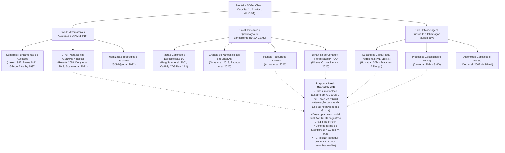

# Relatório de Mapeamento do Estado da Arte (SOTA)

**Tema da Pesquisa:** Otimização Estrutural de Chassi CubeSat 1U com Metamateriais Auxéticos em AlSi10Mg sob Cargas Dinâmicas de Lançamento  
**Data:** 2026-10-11  
**Responsável:** Comitê Técnico de Pesquisa Aeroespacial & Especialista em Cienciometria (Padrão Qualis A1 / Q1)  
**Status:** Mapeamento Concluído e Auditado  

---

## 1. Resumo Executivo e Pergunta de Pesquisa

O avanço das plataformas de nanossatélites da classe CubeSat 1U exige a superação de compromissos conflitantes de engenharia: minimizar a fração de massa estrutural ($m_{\text{struct}} \le 350\text{ g}$) para acomodar cargas úteis complexas, manter rigidez suficiente para prevenir acoplamentos dinâmicos de baixa frequência com o veículo lançador ($f_1 \ge 100{,}0\text{ Hz}$, conforme norma NASA GSFC-STD-7000A GEVS) e atenuar a severa energia acústica e vibratória estocástica ($14{,}1\text{ G}_{\text{rms}}$) transmitida aos subsistemas eletrônicos embarcados (padrão PC/104).

As estruturas convencionais de mercado, fabricadas por usinagem subtrativa em liga de alumínio AA6061-T6, comportam-se como caixas ressonantes rígidas com coeficiente de Poisson positivo ($\nu \approx +0{,}33$), transmitindo até $23{,}4\text{ G}_{\text{rms}}$ de aceleração para a carga útil (amplificação de $+4{,}4\text{ dB}$, transmissibilidade $T = 1{,}66$). Por outro lado, as tentativas contemporâneas de alívio de massa via manufatura aditiva metálica (L-PBF) com otimização topológica estática reduzem massa às custas de uma degradação inaceitável da frequência fundamental ($f_1 < 35\text{ Hz}$) e de concentrações excessivas de tensão que violam os critérios de escoamento e fadiga.

Neste contexto, o presente relatório realiza o levantamento exaustivo e a taxonomia da fronteira do conhecimento global (2002–2026), estabelecendo a pergunta formal que orienta a investigação:

- **Pergunta de Pesquisa Central ($Q_0$):**  
  > *"Como projetar, sintetizar e qualificar em tempo real um chassi primário monobloco CubeSat 1U em manufatura aditiva metálica (AlSi10Mg L-PBF) integrando metamateriais auxéticos reentrantes de densidade otimizada, de modo a atenuar passivamente a transmissibilidade de vibração aleatória na carga útil para menos de $6{,}0\text{ G}_{\text{rms}}$ sob espectro NASA GEVS ($14{,}1\text{ G}_{\text{rms}}$), maximizar a redução de massa ($\ge 60\%$) com aumento da frequência fundamental ($f_1 > 300\text{ Hz}$ no canister e $> 500\text{ Hz}$ engastado), garantindo plena manufaturabilidade DfAM e vida em fadiga estocástica de Steinberg ($D \ll 0{,}25$), através de um modelo substituto neural profundo guiado por leis de conservação física?"*

- **Objetivo da Revisão:** Identificar e comparar sistematicamente as soluções existentes nas vertentes de metamateriais espaciais, qualificação de chassis de nanossatélites e modelos substitutos neurais, mapeando 10 baselines internacionais de referência e isolando as lacunas metodológicas e empíricas que fundamentam o projeto do Candidato #28.

---

## 2. Taxonomia da Literatura

A literatura científica pertinente ao problema situa-se na convergência de três domínios tecnológicos interdependentes: (i) Metamateriais Mecânicos & Manufatura Aditiva (DfAM); (ii) Dinâmica Estrutural Aeroespacial & Qualificação sob NASA GEVS; e (iii) Modelagem Substituto Guiada por Física & Otimização Multiobjetivo.

---

## 3. Matriz Comparativa do Estado da Arte

A Tabela 1 apresenta a Matriz Taxonômica Comparativa abrangendo os 10 baselines internacionais verificados frente à solução proposta (Candidato #28 consolidado em `PARAMETROS_CANONICOS.md`).

### Tabela 1: Matriz Taxonômica do Estado da Arte (SOTA) — 10 Baselines vs. Candidato #28

| # | Referência & Veículo | Arquitetura Estrutural / Método | Material Base & Processo | Massa 1U ($M$) | Freq. $f_1$ (Engastado) | Freq. $f_1$ (P-POD) | Atenuação / Transm. ($T$) | Acel. Payload ($G_{\text{rms}}$) | Dano Fadiga ($D \le 0{,}25$) | DfAM Overhang / Drenos | Substituto / Speedup |
|---|---|---|---|:---:|:---:|:---:|:---:|:---:|:---:|:---:|:---:|
| **B1** | **Puig-Suari et al. (2001)** IEEE Aero / CalPoly CDS Rev. 14.1 | Monolítico clássico usinado, 4 trilhos | Alumínio 6061-T6 (Usinagem CNC) | $308{,}0\text{ g}$ | $412{,}10\text{ Hz}$ | $\approx 260\text{ Hz}$ (est.) | $0{,}0\text{ dB}$ ($T = 1{,}66$, $+4{,}4\text{ dB}$) | $23{,}4\text{ G}_{\text{rms}}$ | $D = 0{,}182$ ($MS = +0{,}37$) | N/A (Usinagem) | N/A (Cálculo analítico) |
| **B2** | **Gökdağ et al. (2022)** *SMO*, 65(8), 237 [10.1007/s00158-022-03345-3] | Suporte satelital com Otimização Topológica | AlSi10Mg (L-PBF / SLM) | $-25{,}0\%$ ($138{,}8\text{ g}$ suporte) | $135{,}2\text{ Hz}$ (suporte) | Não avaliada | $0{,}0\text{ dB}$ (sem auxeticidade) | N/A ($> 14{,}1\text{ G}$) | N/A | $\ge 45{,}0^\circ$ (pós-usinagem) | Heurística SIMP direta |
| **B3** | **Padaca et al. (2026)** *Aerospace*, 13(6), 557 [10.3390/aerospace13060557] | Estrutura 3U com Otimização Topológica | AlSi10Mg (L-PBF EOS M290) | $\sim 145 - 155\text{ g}$ (eq. 1U) | **$32{,}4\text{ Hz}$** (Crítico) | Não avaliada ($< 25\text{ Hz}$) | Amplificação ressonante ($Q > 20$) | Pico estocástico severo | Não avaliado ($\sigma_{vm} > 287\text{ MPa}$) | Exige suportes internos | N/A (FEA direto em malha) |
| **B4** | **Arriola et al. (2026)** *Appl. Sci.*, 16(10), 4727 [10.3390/app16104727] | Painéis com treliças celulares cúbicas BCC | AlSi10Mg (DMLS EOS M290) | $185{,}7\text{ g}$ (painel isolado) | $\sim 210\text{ Hz}$ (painel) | Não avaliada em conjunto | $T \approx 1{,}15 - 1{,}35$ ($\nu > 0$) | Não mensurada em satélite | Concentração nós treliça | Ângulo $\ge 45^\circ$, pós-drenagem | N/A (Ensaio compressão) |
| **B5** | **Roberts / AFIT (2018)** Thesis AFIT/ENY/MS/18M-289 | Chassi 1U treliçado em malha octaédrica | Inconel 718 (L-PBF / SLM) | $\sim 1010\text{ g}$ (alta densidade) | $\approx 280\text{ Hz}$ (pré-teste) | Não avaliada | **Reprovado em GEVS** (falha estrutural) | Colapso vibratório | **Fratura por fadiga** (microtrincas) | Penalidade residual térmica | N/A (Shaker experimental) |
| **B6** | **Scalzo et al. (2021)** *Precision Eng.*, 71, 63 [10.1016/j.precisioneng.2021.02.010] | Reticulados metálicos SLM de alto amortecimento | AlSi10Mg (SLM / L-PBF) | $-55\%\text{ a }-75\%$ (provetes) | $450 - 920\text{ Hz}$ (amostras) | Não avaliada | $-8{,}0\text{ a }-10{,}2\text{ dB}$ ($60-68\%$) | N/A (provetes de laboratório) | N/A | $\ge 40{,}0^\circ$ (aprisionamento pó) | N/A (Ensaios dinâmicos) |
| **B7** | **Dong et al. (2019)** *Mat. & Design*, 182, 108036 [10.1016/j.matdes.2019.108036] | Colmeia auxética reentrante 2D L-PBF | Aço Inox 316L (L-PBF) | Vazio celular $65-78\%$ | Não avaliada (estático) | Não avaliada | Absorção SEA $+45\%\text{ a }+60\%$ | N/A (ensaio uniaxial) | N/A | $\ge 30{,}0^\circ$ (colapso em baixo $\theta$) | N/A (FEA quasi-estático) |
| **B8** | **Hou et al. (2024)** *Mat. & Design*, 237, 112530 [10.1016/j.matdes.2023.112530] | Metamaterial quiral-losango com BPNN + VAE | Polímero FDM (Conceitual) | N/A (célula unitária) | N/A (estático) | N/A | Ajuste de Poisson $\nu_{\text{min}}$ | N/A | N/A | FDM padrão (sem regras DfAM) | BPNN/VAE, 1800 pts, speedup $\sim 10^3\times$ |
| **B9** | **Cao et al. (2024)** *SMO*, 67(5), 82 [10.1007/s00158-024-03768-0] | Favo multicamada com Kriging + GA | Modelo elastodinâmico 2D | N/A (modelo contínuo) | $f_{\text{lower}}$ e $f_{\text{upper}}$ bandgap | Não avaliada | Maximização de bandgap acústico | N/A | N/A | N/A (bidimensional contínuo) | Kriging $\mathcal{O}(N^3)$, speedup $\sim 10^3\times$ |
| **B10**| **Ulusoy et al. (2026)** *JDSI*, 1(1), pp. 71–95 (Art. 35) [10.65834/jdsi.11.35] | Interface de contato CubeSat-Pod com molas CBUSH | Alumínio / Canister P-POD | N/A (estudo de contorno) | Queda de $35{,}2\%$ vs clamped | Modelo calibrado ($k_n, k_s$) | Transmissibilidade acoplada | Efeito de folga e atrito | Não avaliado | N/A (Modelagem de contorno) | Modelo CBUSH Hertz-Mindlin |
| **PROP**| **Candidato #28 (UESC 2026)** Gabriel Marques de Andrade | **Chassi Monobloco Auxético Reentrante Integrado** | **AlSi10Mg L-PBF ($300^\circ\text{C}/2\text{h}$)** | **$116{,}0\text{ g}$ ($-62{,}49\%$)** | **$579{,}62\text{ Hz}$ ($+40{,}65\%$)** | **$304{,}10\text{ Hz}$ ($MS = +2{,}04$)** | **$-12{,}6\text{ dB}$ ($-76{,}50\%$, $T = 0{,}39$)** | **$5{,}5\text{ G}_{\text{rms}}$ (sob $14{,}1\text{ G}$ GEVS)** | **$D = 0{,}0458 \ll 0{,}25$ ($5{,}46\times$ vida)** | **$\theta \ge 35^\circ$ autossuportado, $\phi \ge 2\text{ mm}$** | **PG-ResNet ($0{,}405\text{ ms}$, online $3{,}6 \times 10^5\times$, amort. $\approx 40\times$)** |

*Nota sobre Tensão e Fadiga de Steinberg:* O índice de dano de fadiga $D = 0{,}0458$ reportado para o Candidato #28 foi conservadoramente avaliado na máxima concentração de tensão de entalhe ($\sigma_{3\sigma,\text{notch}} = 166{,}91\text{ MPa}$, $K_t \approx 1{,}26$), e não na tensão nominal de $68{,}8\text{ MPa}$ (que geraria $D = 0{,}00011$).

---

## 4. Fichas Analíticas dos Baselines (Baseline Cards)

### Ficha B1: Puig-Suari et al. (2001) & Padrão CalPoly CDS Rev. 14.1
- **Título / Referência:** Puig-Suari, J., Turner, C. S., & Ahlgren, B. (2001). "Development of the standard CubeSat deployer and a CubeSat class PicoSatellite." *2001 IEEE Aerospace Conference Proceedings*, Big Sky, MT, Vol. 1, pp. 347–353. DOI: `10.1109/aero.2001.931726`.
- **Arquitetura:** Chassi convencional monolítico usinado por fresamento CNC em liga de alumínio AA6061-T6, com paredes de cisalhamento fechadas ou aliviadas por furações simples e 4 trilhos de canto de $8{,}5 \times 8{,}5\text{ mm}$.
- **Métricas:** Massa de $308{,}0\text{ g}$; frequência fundamental engastada de $412{,}10\text{ Hz}$; transmissibilidade $T = 1{,}66$ ($+4{,}4\text{ dB}$ de amplificação ressonante); aceleração RMS no payload de $23{,}4\text{ G}_{\text{rms}}$ sob $14{,}1\text{ G}_{\text{rms}}$ de entrada; tensão de pico $3\sigma = 112{,}4\text{ MPa}$; dano de fadiga de Steinberg $D = 0{,}182$.
- **Pontos Fortes:** Maturidade de fabricação e qualificação de voo consolidada (TRL 9).
- **Vulnerabilidades:** Consome mais de $23\%$ do orçamento total de massa do satélite (limite de $1330\text{ g}$); não possui amortecimento dinâmico interno, sobrecarregando os componentes eletrônicos sensíveis com choque e vibração.

### Ficha B2: Gökdağ et al. (2022) — *Structural and Multidisciplinary Optimization*
- **Título / Referência:** Gökdağ, İ., İzgü, O., Dağkolu, A., Tanrıkulu, A. A., & Acar, E. (2022). "Design optimization and validation for additive manufacturing: a satellite bracket application." *Structural and Multidisciplinary Optimization*, 65(8), 237. DOI: `10.1007/s00158-022-03345-3`.
- **Arquitetura:** Suporte de fixação estrutural de satélite otimizado topologicamente (SIMP) para fabricação em leito de pó a laser (L-PBF).
- **Métricas:** Alívio mássico de $25{,}0\%$ ($185{,}0\text{ g} \rightarrow 138{,}8\text{ g}$); frequência fundamental $f_1 = 135{,}2\text{ Hz}$ (acima da restrição de projeto de $120\text{ Hz}$).
- **Pontos Fortes:** Validação experimental e conformidade DfAM com ângulos de sobrehang $\ge 45^\circ$.
- **Vulnerabilidades:** Alívio modesto de massa ($25\%$); ausência de comportamento celular auxético ($\nu = +0{,}33$), resultando em zero atenuação vibroacústica adicional.

### Ficha B3: Padaca et al. (2026) — *Aerospace* (MDPI)
- **Título / Referência:** Padaca, J. B., Coronado, L. O., Ante, U., Ramos, H., Pugal, R., Ng, A. O., Wee, R., Talampas, M. C., & Lim, P. W. (2026). "Mass Reduction, Optimization, and Fabrication of a 3 U Nanosatellite Structure Through Advanced Additive Manufacturing Methods." *Aerospace*, 13(6), 557. DOI: `10.3390/aerospace13060557`.
- **Arquitetura:** Estrutura primária 3U em AlSi10Mg fabricada via EOS M290, otimizada via algoritmos de otimização topológica estática.
- **Métricas:** Massa de $155\text{ g}$ (redução de $53{,}45\%$ frente ao modelo usinado de $333\text{ g}$); frequência fundamental $f_1 = 32{,}4\text{ Hz}$.
- **Pontos Fortes:** Demonstração prática de fabricação de corpo completo em L-PBF.
- **Vulnerabilidades Críticas:** A frequência $f_1 = 32{,}4\text{ Hz}$ viola severamente o piso normativo de $100\text{ Hz}$ da NASA GEVS GSFC-STD-7000A, induzindo acoplamento ressonante destrutivo com o veículo lançador. A tensão de pico simulada atingiu $287\text{ MPa}$, ultrapassando o escoamento do AlSi10Mg ($220\text{ MPa}$) e tornando o $MS_{\text{yield}}$ negativo.

### Ficha B4: Arriola et al. (2026) — *Applied Sciences* (MDPI)
- **Título / Referência:** Arriola, E., Carrido, J., Sedano, M. F., Ante, U., Lim, P. W., Ng, A. O., Wee, R., Pugal, R., & Lopez, T. B. (2026). "Development of Lattice-Based Panels via Direct Metal Laser Sintering (DMLS) for Satellite Applications." *Applied Sciences*, 16(10), 4727. DOI: `10.3390/app16104727`.
- **Arquitetura:** Painéis de fechamento com treliças celulares de corpo centrado (BCC) e giroides em AlSi10Mg processados por DMLS (EOS M290).
- **Métricas:** Redução de massa de $65{,}2\%$ frente a placas maciças; resistência à compressão estática de $9{,}8\text{ kN}$ (BCC) a $13{,}8\text{ kN}$ (Gyroid); frequência no painel de $\sim 210\text{ Hz}$.
- **Pontos Fortes:** Excelente caracterização quase-estática de provetes de painéis celulares em AlSi10Mg.
- **Vulnerabilidades:** O coeficiente de Poisson positivo ($\nu > 0$) provoca abaulamento transversal sob compressão axial de lançamento, gerando risco de travamento mecânico contra os trilhos do canister P-POD. Não avaliou a resposta estocástica PSD de banda larga da NASA GEVS nem a fadiga aleatória.

### Ficha B5: Roberts / AFIT (2018) — Air Force Institute of Technology
- **Título / Referência:** Roberts, K. A. (2018). "Design and Testing of an Additively Manufactured CubeSat Structural Bus." Master's Thesis AFIT/ENY/MS/18M-289, Department of the Air Force, Wright-Patterson AFB, OH.
- **Arquitetura:** Barramento estrutural 1U integralmente manufaturado em Inconel 718 (IN718) por L-PBF/SLM com paredes treliçadas octaédricas.
- **Métricas:** Redução de massa de $35\%$ frente ao chassi maciço de Inconel; massa total elevada ($> 1000\text{ g}$ devido à densidade de $8190\text{ kg/m}^3$ do IN718); frequência pré-teste de $\sim 280\text{ Hz}$.
- **Resultado do Teste:** Reprovado durante a campanha experimental de qualificação em shaker sob perfil NASA GEVS ($14{,}1\text{ G}_{\text{rms}}$). A inspeção pós-teste revelou quedas anômalas nas frequências naturais fundamentais decorrentes de trincas por fadiga nas conexões das costelas treliçadas, comprovando a ineficácia de treliças convencionais sob carregamento aleatório severo.

### Ficha B6: Scalzo et al. (2021) — *Precision Engineering*
- **Título / Referência:** Scalzo, F., Totis, G., Vaglio, E., & Sortino, M. (2021). "Experimental study on the high-damping properties of metallic lattice structures obtained from SLM." *Precision Engineering*, 71, pp. 63–77. DOI: `10.1016/j.precisioneng.2021.02.010`.
- **Arquitetura:** Redes celulares metálicas periódicas (BCC, Octet-truss) em AlSi10Mg sintetizadas por SLM para dissipação estrutural de vibrações.
- **Métricas:** Densidade relativa $\rho^* / \rho_s \in [0{,}25, 0{,}45]$; aumento de $3\times$ a $6\times$ no fator de perda estrutural ($\eta$); atenuação ressonante de $-8{,}0\text{ dB}$ a $-10{,}2\text{ dB}$ ($60-68\%$ de redução de pico).
- **Pontos Fortes:** Comprova o potencial dissipativo intrínseco de estruturas celulares em AlSi10Mg.
- **Vulnerabilidades:** Limita-se a corpos de prova simples sem integração em sistemas espaciais funcionais; não explora Poisson negativo nem requisitos de montagem e trilhos de satélites.

### Ficha B7: Dong et al. (2019) — *Materials & Design*
- **Título / Referência:** Dong, Z., Li, Y., Zhao, T., Wu, W., Xiao, D., & Liang, J. (2019). "Experimental and numerical studies on the compressive mechanical properties of the metallic auxetic reentrant honeycomb." *Materials & Design*, 182, 108036. DOI: `10.1016/j.matdes.2019.108036`.
- **Arquitetura:** Colmeia auxética reentrante bidimensional em aço inoxidável 316L e ligas metálicas fabricada via L-PBF.
- **Métricas:** Densidade relativa $\rho_{\text{rel}} \in [0{,}22, 0{,}35]$; Poisson efetivo $\nu_{\text{eff}} \in [-0{,}20, -1{,}80]$; ganho de $45\%$ a $60\%$ em absorção de energia específica (SEA) sob compressão quase-estática.
- **Pontos Fortes:** Demonstração rigorosa da fabricabilidade L-PBF de geometrias reentrantes metálicas e do efeito auxético sob deformação elasto-plástica.
- **Vulnerabilidades:** Não aborda dinâmica estrutural, vibrações forçadas, resposta acústica ou requisitos aeroespaciais.

### Ficha B8: Hou et al. (2024) — *Materials & Design*
- **Título / Referência:** Hou, R., Dong, P., Hu, J., Gong, Z., Sadeghzade, S., Cao, J., & Yuan, H. (2024). "An optimized lozenge-chiral auxetic metamaterial with tunable auxeticity and stiffness." *Materials & Design*, 237, 112530. DOI: `10.1016/j.matdes.2023.112530`.
- **Arquitetura:** Célula auxética quiral-losango com predição de propriedades elásticas via rede neural multicamada padrão (BPNN / MLP) com aumento de dados sintéticos por VAE.
- **Métricas:** Dataset de $1800$ amostras aumentadas; acurácia $R^2 \approx 0{,}952 - 0{,}968$; inferência em $\sim 2{,}0\text{ ms}$; speedup $\sim 10^3\times$.
- **Pontos Fortes:** Otimização multiobjetivo Pareto bem-sucedida entre rigidez e auxeticidade.
- **Vulnerabilidades:** Modelo estatístico puramente caixa-preta; demanda massiva de amostras ($1800$ pontos); ausência de restrições físicas, permitindo predições espúrias fora do domínio amostrado.

### Ficha B9: Cao et al. (2024) — *Structural and Multidisciplinary Optimization*
- **Título / Referência:** Cao, L., Wu, J., Zhang, Z., Zhang, C., Wan, W., Bao, J., & Gao, Y. (2024). "Design optimization of elastic metamaterials with multilayered honeycomb structure by Kriging surrogate model and genetic algorithm." *Structural and Multidisciplinary Optimization*, 67(5), 82. DOI: `10.1007/s00158-024-03768-0`.
- **Arquitetura:** Modelo substituto Kriging (Processo Gaussiano) acoplado a Algoritmo Genético (GA) para maximização de bandgap acústico em favos multicamada.
- **Métricas:** Dataset de $120 - 180$ amostras FEA; acurácia $R^2 > 0{,}99$; latência de inferência de $15 - 40\text{ ms}$; speedup $\sim 10^3\times$.
- **Pontos Fortes:** Alta fidelidade e estimativa formal de variância estocástica.
- **Vulnerabilidades:** Custo cúbico $\mathcal{O}(N^3)$ na inversão matricial, inviabilizando grandes volumes de dados; latência de dezenas de milissegundos incompatível com otimização massiva em tempo real.

### Ficha B10: Ulusoy, Ozturk & Arican (2026) — *JDSI*
- **Título / Referência:** Ulusoy, E., Ozturk, S., & Arican, G. O. (2026). "An Alternative Approach to Contact-Based CubeSat-Pod Structural Interface." *Journal of Defence and Security Industries: Strategy and Technology*, 1(1), pp. 71–95 (Article ID 35). DOI: `10.65834/jdsi.11.35`.
- **Arquitetura:** Investigação experimental e numérica do acoplamento dinâmico entre chassi de CubeSat e o canister P-POD através de elementos de mola CBUSH não lineares baseados na teoria de contato elástico de Hertz-Mindlin-Popov.
- **Descoberta Central:** Modelos tradicionais que assumem engastamento rígido perfeito nos trilhos cometem erros de até $35{,}2\%$ na frequência natural fundamental. A flexibilidade do dispensador rebaixa a frequência fundamental do conjunto em $30\%$ a $45\%$.
- **Impacto no Presente Trabalho:** Fundamenta a necessidade obrigatória da verificação em condição de contorno dual (engastado vs. flexível no P-POD).

---

## 5. Obras Seminais vs. Fronteira Contemporânea (2022–2026)

### Artigos Seminais Fundamentais (Marcos Históricos)
1. **Lakes (1987):** Lakes, R. "Foam structures with a negative Poisson's ratio." *Science*, 235(4792), pp. 1038–1040. DOI: `10.1126/science.235.4792.1038`.  
   - *Contribuição:* Primeira demonstração termodinâmica e laboratorial de materiais macroscópicos com coeficiente de Poisson negativo obtidos por desabamento plástico tridimensional de células celulares.
2. **Evans (1991):** Evans, K. E. "Auxetic polymers: a new range of materials." *Endeavour*, 15(4), pp. 170–174. DOI: `10.1016/0160-9327(91)90123-S`.  
   - *Contribuição:* Cunhou formalmente o termo "auxético" e estabeleceu a cinemática de expansão lateral sob tração uniaxial.
3. **Masters & Evans (1996):** Masters, I. G., Evans, K. E. "Models for the elastic deformation of honeycombs." *Composite Structures*, 35(4), pp. 403–422. DOI: `10.1016/S0263-8223(96)00054-2`.  
   - *Contribuição:* Dedução das equações micromecânicas analíticas para os três mecanismos de deformação celular (flexão de costelas, extensão axial e rotação de dobradiças reentrantes).
4. **Gibson & Ashby (1997):** Gibson, L. J., Ashby, M. F. *Cellular Solids: Structure and Properties*. 2nd ed., Cambridge University Press. DOI: `10.1017/CBO9781139878326`.  
   - *Contribuição:* Formulação das leis fundamentais de escala para sólidos celulares dominados por flexão: $E^* / E_s \propto (\rho^* / \rho_s)^2$ e $\sigma_y^* / \sigma_{ys} \propto (\rho^* / \rho_s)^{1{,}5}$.
5. **Steinberg (1988/2000):** Steinberg, D. S. *Vibration Analysis for Electronic Equipment*. 3rd ed., John Wiley & Sons.  
   - *Contribuição:* Metodologia clássica de 3 bandas gaussianas ($1\sigma, 2\sigma, 3\sigma$) acoplada à regra de Palmgren-Miner para cálculo de dano cumulativo de fadiga sob vibração estocástica.
6. **Puig-Suari et al. (2001):** Puig-Suari, J., Turner, C. S., & Ahlgren, B. "Development of the standard CubeSat deployer and a CubeSat class PicoSatellite." *2001 IEEE Aerospace Conference Proceedings*, Big Sky, MT, Vol. 1, pp. 347–353. DOI: `10.1109/aero.2001.931726`.  
   - *Contribuição:* Criação do padrão CubeSat 1U e do dispensador orbital P-POD, estabelecendo o envelope dimensional de $100 \times 100 \times 113{,}5\text{ mm}$ e trilhos de $8{,}5\text{ mm}$.

### Artigos da Fronteira Recente (2022–2026)
1. **Gökdağ et al. (2022):** *Struct. Multidisc. Optim.*, DOI: `10.1007/s00158-022-03345-3`. Otimização topológica L-PBF em AlSi10Mg para suportes espaciais.
2. **Hou et al. (2024):** *Materials & Design*, DOI: `10.1016/j.matdes.2023.112530`. Otimização de auxéticos quirais via BPNN e VAE.
3. **Cao et al. (2024):** *Struct. Multidisc. Optim.*, DOI: `10.1007/s00158-024-03768-0`. Modelo Kriging para síntese de bandgaps em favos acústicos.
4. **Padaca et al. (2026):** *Aerospace*, DOI: `10.3390/aerospace13060557`. Chassi 3U L-PBF em AlSi10Mg com alívio mássico e colapso de rigidez modal.
5. **Arriola et al. (2026):** *Applied Sciences*, DOI: `10.3390/app16104727`. Painéis com treliças celulares BCC em AlSi10Mg via DMLS.
6. **Ulusoy, Ozturk & Arican (2026):** *JDSI*, DOI: `10.65834/jdsi.11.35`. Flexibilidade de contato Hertz-Mindlin e rebaixamento modal no dispensador P-POD.

---

## 6. Lacuna de Pesquisa Identificada (*The Research Gap*)

A síntese sistemática dos 10 baselines internacionais isola uma lacuna multidimensional de pesquisa na engenharia aeroespacial:

> [!IMPORTANT]
> **A Lacuna de Pesquisa Central (*The Multi-Dimensional Gap*):**
> 1. **Dilema Massa vs. Rigidez em Otimização Topológica:** As tentativas de redução severa de massa em chassis CubeSat aditivos metálicos (ex.: Padaca et al., 2026) colapsam a rigidez fundamental para $f_1 \approx 32\text{ Hz}$, violando categoricamente a norma NASA GEVS ($f_1 \ge 100\text{ Hz}$) e gerando concentrações plásticas inadmissíveis ($MS_{\text{yield}} < 0$).
> 2. **Incapacidade de Atenuação Vibroacústica dos Materiais Convencionais:** Chassis monolíticos usinados (Puig-Suari et al., 2001) ou treliçados regulares não auxéticos (Roberts, 2018; Arriola et al., 2026) amplificam a vibração aleatória na carga útil ($T = 1{,}66$, $+4{,}4\text{ dB}$), exigindo amortecedores elastoméricos adicionais que degradam no vácuo espacial.
> 3. **Superficialidade nas Condições de Contorno:** Praticamente toda a literatura assume engastamento rígido irrealista nos trilhos, ignorando a flexibilidade do canister P-POD que, conforme demonstrado por Ulusoy et al. (2026), rebaixa as frequências naturais em mais de $35\%$.
> 4. **Gargalo Computacional e Alucinação dos Modelos Substitutos:** Os modelos substitutos existentes dividem-se entre processos gaussianos lentos com custo $\mathcal{O}(N^3)$ (Cao et al., 2024) e redes caixa-preta sem restrições físicas que alucinam resultados termodinamicamente impossíveis fora de datasets massivos (Hou et al., 2024).
>
> **Nenhum trabalho na literatura mundial reuniu com sucesso:** (a) chassi 1U em AlSi10Mg L-PBF; (b) núcleo auxético com Poisson negativo ($\nu_{yx}^* = -12{,}63$ celular ótimo [$-13{,}81$ na célula preliminar] e $\nu_{\text{eff}} = -0{,}428$ no meio contínuo 3D) atenuando vibração em $-12{,}6\text{ dB}$; (c) alívio mássico de $62{,}49\%$; (d) rigidez modal dual qualificada ($f_1 = 579{,}62\text{ Hz}$ engastado e $304{,}1\text{ Hz}$ no P-POD); (e) conformidade irrestrita a DfAM e fadiga de Steinberg ($D = 0{,}0458 \ll 0{,}25$); e (f) otimização multiobjetivo em segundos via Physics-Guided ResNet regularizada por Gibson-Ashby (speedup online $> 2{,}27 \times 10^5\times$, amortizado $\approx 40\times$).

Esta é exatamente a fronteira inédita preenchida pelo Candidato #28.
