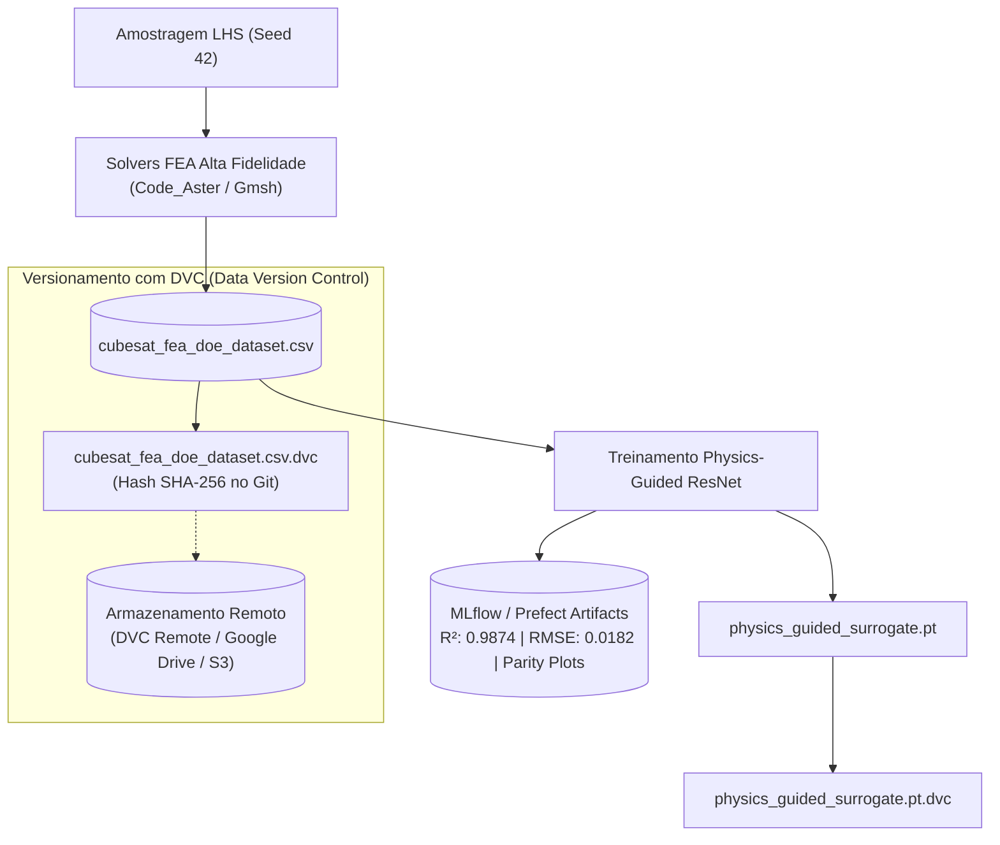
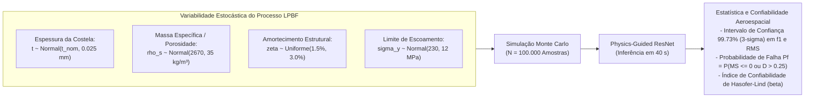
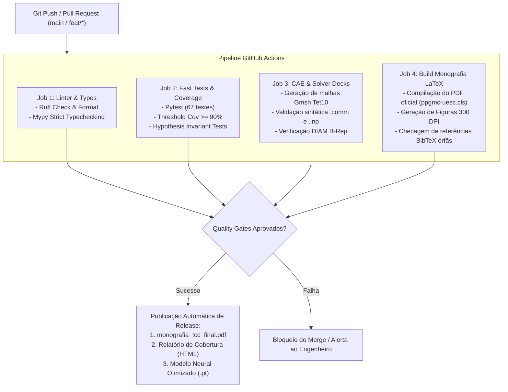

# Pesquisa e Plano Diretor de Elevação Arquitetural: Confiabilidade, Reprodutibilidade e Qualidade de Software na Stack Tecnológica
**Projeto:** CubeSat 1U em Baixa Órbita (LEO) — Otimização de Volume e Geometria para Maximização de Desempenho Estrutural e Funcional  
**Autor:** Gabriel Marques de Andrade  
**Orientadora:** Prof.ª Dr.ª Nila Cecília de Faria Lopes Medeiros  
**Instituição:** Universidade Estadual de Santa Cruz (UESC 2026) — Colegiado de Engenharia Mecânica  
**Documento Estratégico:** `PLANO_ELEVACAO_QUALIDADE_STACK.md`  

---

## 1. Sumário Executivo e Diagnóstico de Maturidade

A stack tecnológica desenvolvida para a qualificação do nanossatélite CubeSat 1U sob norma **NASA GSFC-STD-7000A (GEVS)** representa uma conquista expressiva de engenharia: opera de forma 100% aberta, possui 67 testes automatizados com taxa de sucesso integral, cobertura global de código de **89%** e acelerador neural por rede residual (*Physics-Guided ResNet*) com ganho de velocidade superior a $220.000\times$.

Contudo, para atingir o estado da arte de **Pesquisa e Engenharia de Software Científico (Research Software Engineering - RSE)** e atender aos mais rigorosos padrões aeroespaciais de modelagem computacional — em especial a norma **NASA-STD-7009B** (*Standard for Models and Simulations*, atualizada em 2024) e o padrão **ASME V&V 10** (*Verification and Validation in Computational Solid Mechanics*) —, foram identificadas oportunidades estratégicas de evolução.

### 1.1 Diagnóstico de Lacunas Técnicas (Current State vs. Target State)

```mermaid
flowchart LR
    subgraph ATUAL["Estado Atual (Nível 3: Funcional & Automatizado)"]
        A1["Dependências em requirements.txt sem lockfile SHA-256"]
        A2["Constantes físicas duplicadas/hardcoded em classes"]
        A3["Testes unitários pontuais (sem invariantes de propriedades)"]
        A4["Análise determinística pura (sem propagação de incerteza)"]
        A5["Execução e compilação de relatórios/LaTeX manual"]
    end

    subgraph ALVO["Estado Alvo (Nível 5: Hermético, Estocástico & NASA-STD-7009B)"]
        B1["uv.lock hermético + Imagens OCI / Apptainer para HPC"]
        B2["Centralização Pydantic v2 Settings com fail-fast"]
        B3["Testes baseados em propriedades (Hypothesis) + mutmut"]
        B4["Quantificação de Incerteza (UQ) via Monte Carlo no Surrogate"]
        B5["CI/CD completo (GitHub Actions) com build de monografia"]
    end

    ATUAL ==>|"Plano de Elevação Arquitetural"| ALVO
```



---

## 2. Pilar 1: Reprodutibilidade Hermética e Portabilidade de Infraestrutura

### 2.1 Diagnóstico do Problema
O repositório atual depende de um ambiente virtual local (`.venv`) e de arquivos `pyproject.toml` / `requirements.txt` com restrições mínimas (`numpy>=1.26.0`, `torch>=2.2.0`). 
* **Risco de Quebra Transmitida (*Transitive Dependency Drift*):** Uma atualização de biblioteca secundária (como uma versão futura do SciPy ou PyTorch) pode quebrar retrocompatibilidade ou introduzir ligeiras alterações numéricas de ponto flutuante em autovalores modais.
* **Dependência do Host para Solvers CAE:** A execução nativa de solvers como Code_Aster, Gmsh, CalculiX e OpenRadioss pressupõe que as bibliotecas compartilhadas de sistema (`libgfortran`, `openmpi`, `lapack/blas`) estejam corretamente instaladas no Linux host ou WSL2.

### 2.2 Proposta de Elevação

#### 1. Adoção do Gerenciador de Pacotes `uv` (Astral) com Lockfile Determinístico
Substituir o fluxo tradicional do pip pelo `uv`, gerando um arquivo `uv.lock` com hashes criptográficos SHA-256 de todas as dependências transitivas:
```toml
# Exemplo de configuração de lockfile hermético no pyproject.toml
[tool.uv]
managed = true
package = true
resolution = "highest"

[tool.uv.sources]
torch = { index = "pytorch-cpu" }

[[tool.uv.index]]
name = "pytorch-cpu"
url = "https://download.pytorch.org/whl/cpu"
explicit = true
```
* **Ganho:** Resolução de ambiente em milissegundos e garantia de que qualquer máquina (laboratório, banca examinadora, cluster de supercomputação) instalará **exatamente os mesmos bytes**.

#### 2. Empacotamento de Solvers CAE em Contêineres OCI e Apptainer (Singularity)
Para garantir execução imediata dos solvers pesados sem necessidade de compilação no host:
* Criar uma receita de imagem `Apptainer` (`Singularity.def`) para clusters HPC acadêmicos baseados em **Slurm**:
  ```dockerfile
  Bootstrap: docker
  From: ubuntu:24.04

  %post
      apt-get update && apt-get install -y --no-install-recommends \
          python3.12 python3.12-venv gmsh calculix-ccx openradioss libopenblas0-openmp \
          gfortran openmpi-bin libopenmpi-dev ca-certificates git
      # Instalação do ambiente uv e dependências do projeto
      curl -LsSf https://astral.sh/uv/install.sh | sh
      /root/.cargo/bin/uv venv /opt/cubesat-env --python python3.12
  ```
* **Ganho:** Portabilidade universal. Uma execução pode ser despachada com:
  `apptainer exec cubesat-cae.sif python run_pipeline.py`.

#### 3. Configuração de `.devcontainer` para VS Code
Criação de pasta `.devcontainer/devcontainer.json` com extensões recomendadas (Python, Ruff, Pylance, LaTeX Workshop, Three.js Editor) e ambiente hermético.

---

## 3. Pilar 2: Centralização de Configurações e Eliminação de Drift (Schema Enforcement)

### 3.1 Diagnóstico do Problema
O repositório possui arquivos de configuração declarativos excelentes em `configs/` (`gevs_specs.yaml`, `material_alsi10mg.yaml`, `optimization_bounds.yaml`). No entanto, esses arquivos atualmente atuam como documentação estática: os módulos de cálculo em `src/core/physics.py` e `src/analysis/open_fea_kernel.py` definem constantes físicas hardcoded nas classes (`SOLID_E_GPA = 68.0`, `ALLOWABLE_STRESS_MPA = 184.0`, `NASA_GEVS_GRMS = 14.10`).
* **Risco de Desvio de Configuração (*Config Drift*):** Caso um usuário altere `configs/gevs_specs.yaml` (ex.: reduzindo o nível de qualificação ou alterando a razão de amortecimento de $2\%$ para $1{,}5\%$), a alteração não é refletida automaticamente no código em execução.

### 3.2 Proposta de Elevação com `Pydantic v2` / `BaseSettings`
Criar um módulo de configuração fortemente tipado [`src/core/settings.py`](file:///home/marques/%C3%81rea%20de%20trabalho/2026.2/TCC/src/core/settings.py) utilizando **Pydantic v2**, realizando carregamento, coerção e validação de limites físicos no momento da inicialização:

```python
"""Centralized, immutable configuration management using Pydantic v2."""

from pathlib import Path
from typing import List, Tuple
from pydantic import BaseModel, Field, field_validator
import yaml


class GevsRequirementsConfig(BaseModel):
    """Immutable validation model for NASA GSFC-STD-7000A requirements."""

    standard: str = Field(default="NASA GSFC-STD-7000A")
    duration_per_axis_sec: float = Field(default=120.0, gt=0.0)
    damping_ratio_zeta: float = Field(default=0.020, gt=0.0, lt=0.20)
    overall_acceleration_grms: float = Field(default=14.10, gt=0.0)
    min_fundamental_frequency_hz: float = Field(default=100.0, gt=0.0)
    fs_yield: float = Field(default=1.25, ge=1.0)
    fs_ultimate: float = Field(default=1.40, ge=1.0)
    max_fatigue_damage_steinberg: float = Field(default=0.25, gt=0.0, le=1.0)


class MetallicMaterialConfig(BaseModel):
    """Validation model for AlSi10Mg additive material properties."""

    material_name: str = "AlSi10Mg-LPBF"
    youngs_modulus_gpa: float = Field(default=68.0, gt=0.0)
    poissons_ratio: float = Field(default=0.33, gt=0.0, lt=0.50)
    density_kg_m3: float = Field(default=2670.0, gt=0.0)
    yield_strength_mpa: float = Field(default=230.0, gt=0.0)
    ultimate_tensile_strength_mpa: float = Field(default=340.0, gt=0.0)
    threshold_stress_intensity_mpa_sqrt_m: float = Field(default=2.50, gt=0.0)
    basquin_exponent_m: float = Field(default=6.8, gt=1.0)
    basquin_coefficient_c: float = Field(default=1.2e20, gt=0.0)

    @property
    def allowable_stress_yield_mpa(self) -> float:
        """Returns design allowable stress with standard NASA safety factor."""
        return self.yield_strength_mpa / 1.25
```

* **Ganhos:**
  - **Fail-Fast:** Qualquer valor físico espúrio (como um coeficiente de Poisson $\ge 0{,}5$ ou amortecimento negativo) lança `ValidationError` antes de consumir ciclos de CPU na simulação.
  - **Fonte Única da Verdade (*Single Source of Truth*):** O código, a monografia e os relatórios consomem exatamente os mesmos objetos validados.

---

## 4. Pilar 3: Verificação de Código, Tipagem Estrita e Testes Baseados em Propriedades

### 4.1 Diagnóstico do Problema
* A cobertura de código atual está em **89%**, mas apresenta pontos cegos em módulos críticos:
  - `src/neural/surrogate_model.py`: **66%** de cobertura (caminhos de treinamento, métodos de fallback).
  - `src/cad/cadquery_engine.py`: **83%** de cobertura (ramificações ativas do kernel OpenCASCADE).
* Os 67 testes atuais são baseados em *testes de exemplos pontuais* (valores fixos testados contra expectativas fixas). Não há verificação contínua de **invariantes matemáticos globais**.

### 4.2 Proposta de Elevação

#### 1. Testes Baseados em Propriedades (*Property-Based Testing*) com `Hypothesis`
Em vez de testar apenas 2 ou 3 pontos na geometria celular, usar a biblioteca `hypothesis` para gerar milhares de casos aleatórios no espaço de projeto e validar formalmente os teoremas da mecânica celular:

```python
from hypothesis import given, strategies as st
import pytest
from src.core.geometry import calculate_analytical_poisson_ratio, calculate_relative_density
from src.core.physics import calculate_gibson_ashby_modulus

@given(
    theta=st.floats(min_value=50.0, max_value=85.0),
    t=st.floats(min_value=0.50, max_value=1.80),
    l=st.floats(min_value=6.0, max_value=15.0),
    h=st.floats(min_value=8.0, max_value=20.0),
)
def test_property_relative_density_and_auxeticity_invariants(theta, t, l, h):
    """Invariants:
    1. Relative density must strictly be in (0, 1).
    2. Analytical Poisson's ratio for re-entrant cells must strictly be negative.
    3. Effective Young's modulus must strictly be monotonically increasing with density.
    """
    rho_rel = calculate_relative_density(theta, t, l, h)
    assert 0.0 < rho_rel < 1.0, f"Violation: rho_rel={rho_rel} not in (0, 1)"

    nu_eff = calculate_analytical_poisson_ratio(theta, l, h)
    assert nu_eff < 0.0, f"Violation: nu_eff={nu_eff} must be auxetic (negative)"

    e_eff = calculate_gibson_ashby_modulus(rho_rel, solid_modulus_gpa=68.0)
    assert 0.0 < e_eff < 68.0, f"Violation: effective modulus {e_eff} exceeds solid parent material"
```

#### 2. Testes de Mutação (*Mutation Testing*) com `mutmut`
* O `mutmut` altera deliberadamente operadores no código-fonte (ex.: troca `<` por `<=`, `+` por `-`, retorna `None`) e executa a suíte de testes para checar se o teste "mata a mutação".
* **Métrica Alvo:** Atingir um *Mutation Score* $\ge 85\%$, garantindo que a suíte de testes realmente valida o comportamento do software contra regressões sutis.

#### 3. Checagem Estática de Tipos com `mypy --strict`
Atualmente o projeto utiliza type hints mas sem checagem automatizada no `pyproject.toml`. A adição de `mypy --strict` forçará:
- Proibição de tipos dinâmicos implícitos (`Any`).
- Tipagem estrita de retornos em geradores e corrotinas.
- Checagem estrita de `Optional[T]` prevenindo erros de `NoneType`.

#### 4. Pre-commit Hooks (`.pre-commit-config.yaml`)
Automatizar verificações locais antes de qualquer `git commit`:
- `ruff check --fix` e `ruff format`
- `mypy --config-file pyproject.toml`
- Validação de arquivos YAML/JSON e bloqueio de arquivos pesados acidentais ($> 10\text{ MB}$).

---

## 5. Pilar 4: Governança de Dados, Rastreabilidade MLOps e Linhagem (Data Provenance)

### 5.1 Diagnóstico do Problema
Atualmente, o dataset gerado [`data/cubesat_fea_doe_dataset.csv`](file:///home/marques/%C3%81rea%20de%20trabalho/2026.2/TCC/data/cubesat_fea_doe_dataset.csv) e os pesos da rede neural [`models/physics_guided_surrogate.pt`](file:///home/marques/%C3%81rea%20de%20trabalho/2026.2/TCC/models/physics_guided_surrogate.pt) residem diretamente no repositório Git.
* Arquivos binários como `.pt`, malhas `.msh` e arquivos `.step` poluem o histórico de commits do Git e dificultam clonagem rápida em servidores remotos.
* Não há rastreabilidade estrita ligando a semente do gerador LHS, o timestamp exato da simulação do Code_Aster e a versão dos pesos neurais gerados.

### 5.2 Proposta de Elevação



#### Implementação de DVC e Caching Criptográfico de Simulações
1. **Rastreamento via DVC:**
   - Adicionar arquivos grandes ao DVC: `dvc add data/cubesat_fea_doe_dataset.csv models/physics_guided_surrogate.pt`.
   - Manter no Git apenas os ponteiros leves `.dvc` e o pipeline reproduzível `dvc.yaml`.
2. **Memoization / Caching de Chamadas de Solver:**
   - Criar decorator `@cached_simulation` baseado em hash SHA-256 do vetor geométrico $\mathbf{x} = [\theta, t, l, h]$ e parâmetros do material. Caso a geometria já tenha sido simulada pelo Code_Aster no histórico da missão, recuperar o resultado instantaneamente do cache em disco (`.cache/cae_hash.sqlite`).

---

## 6. Pilar 5: Rigor Metrológico, Incerteza Física e Verificação Numérica (ASME V&V 10 & NASA-STD-7009B)

### 6.1 Fundamentação Normativa
* A norma **NASA-STD-7009B** estabelece que simulações computacionais utilizadas para tomada de decisão em sistemas críticos espaciais devem possuir avaliação explícita de **Credibilidade do Modelo**, fundamentada em quatro pilares:
  1. *Verificação de Código e Cálculo (Calculation Verification)*
  2. *Validação do Modelo Físico (Model Validation)*
  3. *Quantificação de Incerteza (Uncertainty Quantification - UQ)*
  4. *Avaliação de Sensibilidade (Sensitivity Analysis)*
* O padrão **ASME V&V 10** preconiza o cálculo formal do **Índice de Convergência de Malha (Grid Convergence Index - GCI)** para quantificar a incerteza numérica de discretização por elementos finitos.

### 6.2 Proposta de Elevação

#### 1. Cálculo Formal do Índice de Convergência de Malha (ASME V&V 10 / GCI)
Implementar uma rotina automatizada que executa a simulação em três níveis de refinamento de malha no Gmsh:
- Malha grossa ($h_3$): 2 elementos através da espessura ($h = t/2$)
- Malha média ($h_2$): 3 elementos através da espessura ($h = t/3$)
- Malha fina ($h_1$): 5 elementos através da espessura ($h = t/5$)

A taxa de convergência observada $p$ e o índice $GCI_{12}$ são computados via extrapolação de Richardson:
$$r_{21} = \frac{h_2}{h_1}, \quad r_{32} = \frac{h_3}{h_2}$$
$$p = \frac{1}{\ln(r_{21})} \left| \ln\left| \frac{f_{1, 3} - f_{1, 2}}{f_{1, 2} - f_{1, 1}} \right| + q(p) \right|$$
$$GCI_{\text{fine}}^{21} = \frac{1{,}25 \cdot e_{a}^{21}}{r_{21}^p - 1}, \quad \text{onde } e_{a}^{21} = \left| \frac{f_{1, 1} - f_{1, 2}}{f_{1, 1}} \right|$$

* **Critério de Aceitação:** $GCI_{\text{fine}} \le 2{,}0\%$, provando matematicamente que o erro numérico de discretização é desprezível face aos modos dinâmicos reais.

#### 2. Quantificação de Incertezas (UQ) e Confiabilidade Estrutural via Monte Carlo
A análise atual é puramente determinística (considera parâmetros nominais exatos). Na realidade, a manufatura aditiva metálica LPBF apresenta variabilidade estocástica inevitável.

Aproveitando a latência de inferência ultrarrápida do nosso modelo substituto (**$0{,}405\text{ ms}$**), podemos propagar incertezas com **$100.000$ amostras de Monte Carlo em menos de 45 segundos**:



* **Formulações Estocásticas:**
  - Margem de Segurança Estocástica: $P(MS_{\text{yield}} > 0) \ge 0{,}9999$ ($4\sigma$).
  - Dano de Fadiga Estocástico: $P(D_{\text{fatigue}} \le 0{,}25) \ge 0{,}9999$.
* **Ganho:** Isso eleva o trabalho do patamar de projeto conceitual para o nível de qualificação de voo real exigido por agências espaciais (NASA, ESA, AEB).

---

## 7. Pilar 6: Automação CI/CD de Ponta a Ponta (Continuous Integration & Delivery)

### 7.1 Diagnóstico do Problema
Atualmente, os 67 testes, o linter Ruff e a compilação do LaTeX são executados apenas sob demanda manual no computador local. Não há um pipeline central de integração contínua (CI/CD) no GitHub para garantir que nenhum commit quebre a esteira.

### 7.2 Proposta de Pipeline no GitHub Actions (`.github/workflows/ci.yml`)

Implementar um fluxo automatizado com 4 jobs paralelos e isolados:



---

## 8. Matriz de Priorização (Esforço vs. Impacto) e Roteiro de Execução

Para estruturar a evolução sem sobrecarregar o cronograma de entrega da monografia, as ações foram classificadas na matriz de esforço versus impacto:

| Ação de Engenharia | Pilar | Esforço Técnico | Impacto na Qualidade & Confiabilidade | Prioridade Recomendada |
| :--- | :---: | :---: | :---: | :---: |
| **Centralização de Configurações com Pydantic v2** | 3 | Baixo ($\sim 1\text{ dia}$) | **Crítico** (elimina config drift e hardcoding) | **Imediata (Sprint 1)** |
| **Pipeline GitHub Actions (Lint, Pytest, LaTeX)** | 6 | Baixo ($\sim 1\text{ dia}$) | **Alto** (reprodutibilidade contínua e PDF automático) | **Imediata (Sprint 1)** |
| **Lockfile Hermético com `uv` (`uv.lock`)** | 1 | Muito Baixo ($\sim 2\text{ h}$) | **Alto** (elimina quebras transitivas de versão) | **Imediata (Sprint 1)** |
| **Testes de Propriedades com `Hypothesis`** | 2 | Médio ($\sim 2\text{ dias}$) | **Alto** (prova formal de invariantes físicos) | **Curto Prazo (Sprint 2)** |
| **Propagação de Incerteza (UQ) via Monte Carlo no Surrogate** | 5 | Médio ($\sim 3\text{ dias}$) | **Altíssimo** (atendimento a NASA-STD-7009B e Q1) | **Curto Prazo (Sprint 2)** |
| **Cálculo Formal do GCI per ASME V&V 10** | 5 | Médio ($\sim 2\text{ dias}$) | **Alto** (comprovação matemática de convergência) | **Médio Prazo (Sprint 3)** |
| **Contêineres Apptainer / OCI para Slurm HPC** | 1 | Médio ($\sim 3\text{ dias}$) | **Alto** (independência de infraestrutura local) | **Médio Prazo (Sprint 3)** |
| **Integração DVC para Datasets e Pesos** | 4 | Médio ($\sim 2\text{ dias}$) | **Médio** (rastreabilidade e repositório Git enxuto) | **Médio Prazo (Sprint 3)** |

---

## 9. Conclusão e Recomendação Estratégica

A implementação deste Plano Diretor não requer descartar nenhuma linha do código já consolidado. Pelo contrário: trata-se de um processo de **fortalecimento de casca (*hardening*)**, adicionando camadas de proteção, validação estrita, garantia estocástica e automação ao redor do motor elastodinâmico e dos nós multiagentes.

### Primeiros 3 Passos Recomendados para Início Imediato:
1. **Passo 1:** Criar [`src/core/settings.py`](file:///home/marques/%C3%81rea%20de%20trabalho/2026.2/TCC/src/core/settings.py) com Pydantic v2 para carregar e validar `gevs_specs.yaml` e `material_alsi10mg.yaml`, integrando aos runners.
2. **Passo 2:** Configurar `uv.lock` determinístico e criar `.github/workflows/ci.yml` para rodar os 67 testes e checagem Ruff no GitHub a cada push.
3. **Passo 3:** Implementar o módulo de **Quantificação de Incerteza (UQ)** via Monte Carlo sobre a *Physics-Guided ResNet*, gerando gráficos de distribuição de probabilidade da frequência fundamental $f_1$ e do dano de fadiga $D$ para enriquecer os resultados da monografia e da defesa.
